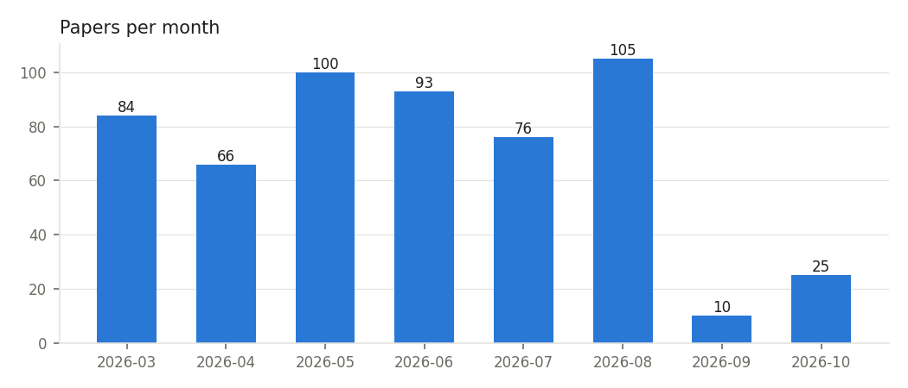
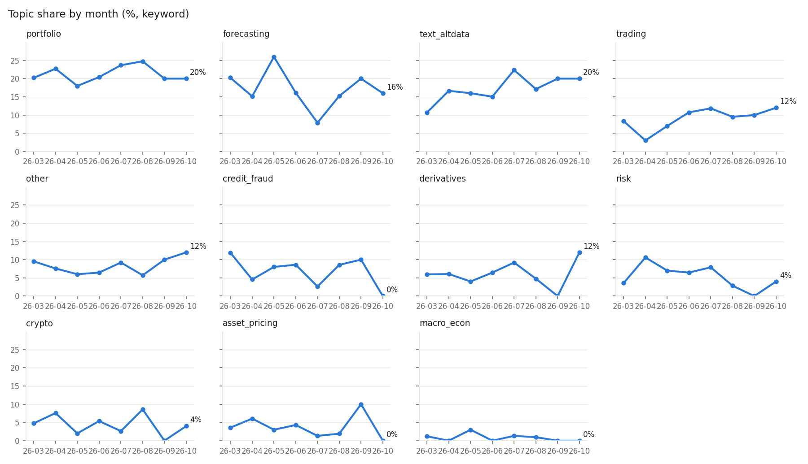
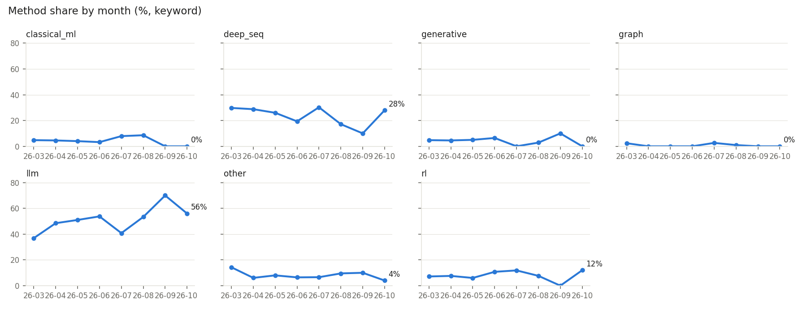

# 금융 머신러닝 (Financial Machine Learning) 연구 동향 보고서

- 생성: 2026-11-09 05:50 · 분류 방식: **keyword**
- 데이터: arXiv API, 2026-03 ~ 2026-11 (9개월), 논문 564건
- 월별 비중은 LLM 이 아니라 코드로 계산 (해당 월 논문 수 대비 비율)

## 1. 월별 논문 수

## 2. 주제별 월별 비중

| 주제 | 논문 수 | 전체 비중 | 26-03 | 26-04 | 26-05 | 26-06 | 26-07 | 26-08 | 26-09 | 26-10 | 26-11 | 전반→후반 (%p) |
|---|---:|---:|---:|---:|---:|---:|---:|---:|---:|---:|---:|---:|
| 포트폴리오·자산배분 | 121 | 21.5% | 20% | 23% | 18% | 20% | 24% | 25% | 20% | 20% | 20% | +3.4 |
| 수익률·가격 예측 | 98 | 17.4% | 20% | 15% | 26% | 16% | 8% | 15% | 20% | 16% | 40% | -6.3 |
| 금융 텍스트·감성·대체데이터 | 92 | 16.3% | 11% | 17% | 16% | 15% | 22% | 17% | 20% | 20% | 0% | +4.4 |
| 트레이딩·시장 미시구조 | 51 | 9.0% | 8% | 3% | 7% | 11% | 12% | 10% | 10% | 12% | 40% | +3.7 |
| 기타 | 42 | 7.4% | 10% | 8% | 6% | 6% | 9% | 6% | 10% | 12% | 0% | +0.4 |
| 신용·사기탐지·은행 | 41 | 7.3% | 12% | 5% | 8% | 9% | 3% | 9% | 10% | 0% | 0% | -3.0 |
| 파생상품 가격결정·헤징 | 34 | 6.0% | 6% | 6% | 4% | 6% | 9% | 5% | 0% | 12% | 0% | +1.2 |
| 리스크·변동성 | 33 | 5.9% | 4% | 11% | 7% | 6% | 8% | 3% | 0% | 4% | 0% | -2.2 |
| 암호화폐·DeFi | 28 | 5.0% | 5% | 8% | 2% | 5% | 3% | 9% | 0% | 4% | 0% | +0.8 |
| 자산가격결정·팩터 | 18 | 3.2% | 4% | 6% | 3% | 4% | 1% | 2% | 10% | 0% | 0% | -2.3 |
| 거시경제·정책 | 6 | 1.1% | 1% | 0% | 3% | 0% | 1% | 1% | 0% | 0% | 0% | -0.3 |

> ⚠️ 논문이 30건 미만인 달은 비중이 크게 흔들리므로 해석에 주의: 2026-09 (10건), 2026-10 (25건), 2026-11 (5건)

## 3. 증가·감소 주제

**증가**: 금융 텍스트·감성·대체데이터 (+4.4%p, 기울기 -0.38%p/월), 트레이딩·시장 미시구조 (+3.7%p, 기울기 +2.64%p/월), 포트폴리오·자산배분 (+3.4%p, 기울기 -0.01%p/월)

**감소**: 수익률·가격 예측 (-6.3%p, 기울기 +1.15%p/월), 신용·사기탐지·은행 (-3.0%p, 기울기 -0.95%p/월), 자산가격결정·팩터 (-2.3%p, 기울기 -0.35%p/월)

## 4. 주제별 요약과 근거 논문

### 포트폴리오·자산배분 (121건)

근거 논문:
- (2026-10) [Causal Value Attribution of Marketing Labels in LLM-Generated Ads: A Deconfounder Approach](http://arxiv.org/abs/2610.23025v1)
- (2026-10) [FARO: Function-Space Adaptive Return-to-Risk Optimization via Cross-Block Equal-Risk-Contribution Budget Allocation](http://arxiv.org/abs/2610.40858v1)
- (2026-11) [StockASkill: A Local-First AgentSkill for Intelligent Stock Selection](http://arxiv.org/abs/2611.09528v1)

### 수익률·가격 예측 (98건)

근거 논문:
- (2026-10) [Conditional Neural SDEs for Financial Time-Series Generation](http://arxiv.org/abs/2610.41405v1)
- (2026-11) [Neural Realized Measures: Forecast-Supervised Intraday Aggregation for Volatility Forecasting](http://arxiv.org/abs/2611.07287v1)
- (2026-11) [TailDART: Compute-Efficient Foundation Models for Financial Time-Series Forecasting](http://arxiv.org/abs/2611.09176v1)

### 금융 텍스트·감성·대체데이터 (92건)

근거 논문:
- (2026-10) [Reading the News Without Hindsight: NoLBERT Topics and the Cross-Section of Stock Returns](http://arxiv.org/abs/2610.22745v1)
- (2026-10) [When News Gets Old: Portfolio Allocation with Reinforcement Learning and Large Language Models](http://arxiv.org/abs/2610.30564v1)
- (2026-10) [Governed Self-Evolution for Autonomous Investing: A Multi-Agent LLM System with an Invariant Core](http://arxiv.org/abs/2610.30557v1)

### 트레이딩·시장 미시구조 (51건)

근거 논문:
- (2026-10) [Financial Context-Rich Strategy for Actor-Critic based Agents: A Deep Reinforcement Learning Approach for Stock Trading](http://arxiv.org/abs/2610.32237v1)
- (2026-11) [Does a Trading Policy Need to Know What It Trades? Microstructure Invariance and Zero-Shot Transfer of Execution Policies](http://arxiv.org/abs/2611.08701v1)
- (2026-11) [Towards Robust Reinforcement Learning Market Making: Lessons from Loss Function Experimentation](http://arxiv.org/abs/2611.09012v1)

### 기타 (42건)

근거 논문:
- (2026-10) [Same Person, Different Advice: Auditing LLM Financial Advice with Repeated Risk-Tolerance Responses](http://arxiv.org/abs/2610.23060v1)
- (2026-10) [Profile-Driven User Simulation via Reinforcement Learning with Hierarchical Rewards for Task-Oriented Dialogues](http://arxiv.org/abs/2610.32435v1)
- (2026-10) [The psychophysics of affect in large language models](http://arxiv.org/abs/2610.40985v1)

### 신용·사기탐지·은행 (41건)

근거 논문:
- (2026-08) [A Temporal Multiplex Graph Neural Network for Systemic Risk Transmission in Global Banking](http://arxiv.org/abs/2608.27295v1)
- (2026-08) [Oculi: A Conversational Agentic Platform for Automated Credit Risk Analysis](http://arxiv.org/abs/2608.28944v1)
- (2026-09) [Financial Fragility in Societies of LLM Agents: Coordination Failures and Stabilizing Mechanisms](http://arxiv.org/abs/2609.30940v1)

### 파생상품 가격결정·헤징 (34건)

근거 논문:
- (2026-10) [Shapley-based Structural Analysis of Neural Calibration for Stochastic Volatility Models](http://arxiv.org/abs/2610.03076v1)
- (2026-10) [On the continuity of conditional distributions and stratification for derivative pricing](http://arxiv.org/abs/2610.32970v1)
- (2026-10) [Neural Network Methods in the 2BSDE Formalism for Solving the High-Dimensional Black--Scholes Equation with Transaction Costs](http://arxiv.org/abs/2610.41019v1)

### 리스크·변동성 (33건)

근거 논문:
- (2026-08) [Beyond Forecasting: Recasting Volatility Control as a Routing Problem](http://arxiv.org/abs/2608.10375v1)
- (2026-08) [Asymptotically-informed neural networks for Black-Scholes implied volatility computation](http://arxiv.org/abs/2609.05491v1)
- (2026-10) [A Distributional Framework for Behavioral Characterization and Risk Management of Large Language Models](http://arxiv.org/abs/2610.12718v1)

### 암호화폐·DeFi (28건)

근거 논문:
- (2026-08) [Quality over Quantity: Semi-Supervised Detection of Illicit Bitcoin Flows via Feature Engineering](http://arxiv.org/abs/2609.27936v1)
- (2026-08) [An Open-Source, Event-Driven Pipeline for Cryptocurrency Market Data: Ingestion, Forecasting, and On-Chain Fraud Detection](http://arxiv.org/abs/2608.29973v1)
- (2026-10) [OnTrack: Real-Time Monitoring and Intervention in LLM Agent Trajectories via Streaming Structure-Aware Optimal Transport](http://arxiv.org/abs/2610.12375v1)

### 자산가격결정·팩터 (18건)

근거 논문:
- (2026-08) [Cross-Sectional Heterogeneity in LSTM Networks for Financial Time Series](http://arxiv.org/abs/2608.05755v2)
- (2026-08) [AlphaSeek: Trajectory-Level Self-Iterative Factor Mining Framework for Multi-Source Financial Data](http://arxiv.org/abs/2608.13913v1)
- (2026-09) [AlphaDiverse: Post-Training Local Quantitative Research Agents for Diverse Exploration in Alpha Factor Mining](http://arxiv.org/abs/2609.29014v1)

### 거시경제·정책 (6건)

근거 논문:
- (2026-05) [Deep Least Squares Monte Carlo methods for the valuation of variable annuities with guarantees](http://arxiv.org/abs/2605.27182v1)
- (2026-07) [Augmenting Fundamental Analysis with Large Language Models: A RAG-Based System for Generating Investor Briefs](http://arxiv.org/abs/2607.09121v1)
- (2026-08) [Can LLMs Take the Pulse of the Economy? A Real-Time Evaluation of LLM Nowcasts on Macroeconomic Indicators](http://arxiv.org/abs/2608.30110v1)

## 5. 방법론 비중 (보조)

| 방법론 | 26-03 | 26-04 | 26-05 | 26-06 | 26-07 | 26-08 | 26-09 | 26-10 | 26-11 |
|---|---:|---:|---:|---:|---:|---:|---:|---:|---:|
| 전통 ML(트리·선형·SVM) | 5% | 5% | 4% | 3% | 8% | 9% | 0% | 0% | 0% |
| 딥러닝 시계열(Transformer·RNN 등) | 30% | 29% | 26% | 19% | 30% | 17% | 10% | 28% | 20% |
| 생성모델(Diffusion·GAN·VAE) | 5% | 5% | 5% | 6% | 0% | 3% | 10% | 0% | 0% |
| 그래프 신경망 | 2% | 0% | 0% | 0% | 3% | 1% | 0% | 0% | 0% |
| LLM·생성형 에이전트 | 37% | 48% | 51% | 54% | 41% | 53% | 70% | 56% | 20% |
| 기타/통계·이론 | 14% | 6% | 8% | 6% | 7% | 10% | 10% | 4% | 20% |
| 강화학습 | 7% | 8% | 6% | 11% | 12% | 8% | 0% | 12% | 40% |
