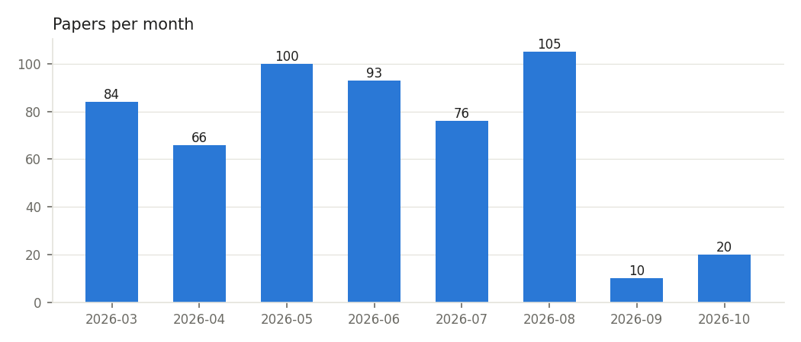
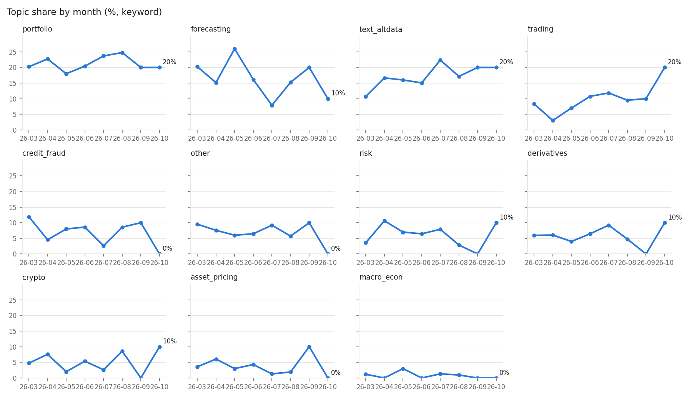
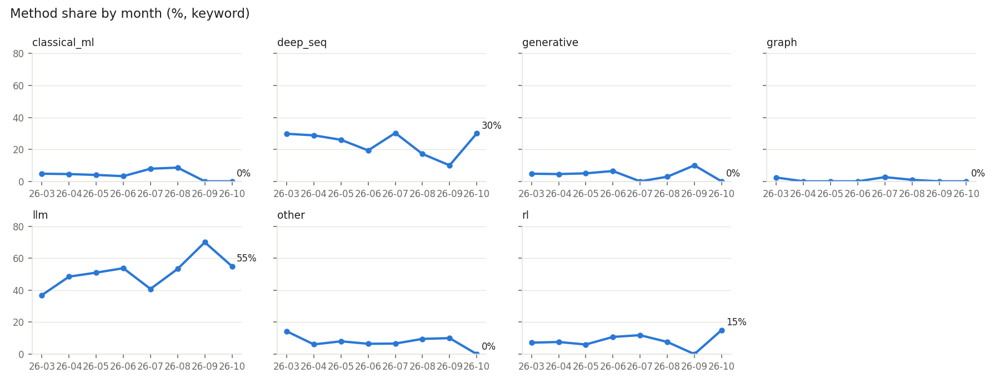

# 금융 머신러닝 (Financial Machine Learning) 연구 동향 보고서

- 생성: 2026-10-26 04:20 · 분류 방식: **keyword**
- 데이터: arXiv API, 2026-03 ~ 2026-10 (8개월), 논문 554건
- 월별 비중은 LLM 이 아니라 코드로 계산 (해당 월 논문 수 대비 비율)

## 1. 월별 논문 수

## 2. 주제별 월별 비중

| 주제 | 논문 수 | 전체 비중 | 26-03 | 26-04 | 26-05 | 26-06 | 26-07 | 26-08 | 26-09 | 26-10 | 전반→후반 (%p) |
|---|---:|---:|---:|---:|---:|---:|---:|---:|---:|---:|---:|
| 포트폴리오·자산배분 | 119 | 21.5% | 20% | 23% | 18% | 20% | 24% | 25% | 20% | 20% | +3.6 |
| 수익률·가격 예측 | 94 | 17.0% | 20% | 15% | 26% | 16% | 8% | 15% | 20% | 10% | -7.5 |
| 금융 텍스트·감성·대체데이터 | 92 | 16.6% | 11% | 17% | 16% | 15% | 22% | 17% | 20% | 25% | +5.3 |
| 트레이딩·시장 미시구조 | 49 | 8.8% | 8% | 3% | 7% | 11% | 12% | 10% | 10% | 15% | +3.3 |
| 기타 | 41 | 7.4% | 10% | 8% | 6% | 6% | 9% | 6% | 10% | 10% | +0.3 |
| 신용·사기탐지·은행 | 41 | 7.4% | 12% | 5% | 8% | 9% | 3% | 9% | 10% | 0% | -2.8 |
| 파생상품 가격결정·헤징 | 33 | 6.0% | 6% | 6% | 4% | 6% | 9% | 5% | 0% | 10% | +1.1 |
| 리스크·변동성 | 33 | 6.0% | 4% | 11% | 7% | 6% | 8% | 3% | 0% | 5% | -2.0 |
| 암호화폐·DeFi | 28 | 5.1% | 5% | 8% | 2% | 5% | 3% | 9% | 0% | 5% | +1.0 |
| 자산가격결정·팩터 | 18 | 3.2% | 4% | 6% | 3% | 4% | 1% | 2% | 10% | 0% | -2.2 |
| 거시경제·정책 | 6 | 1.1% | 1% | 0% | 3% | 0% | 1% | 1% | 0% | 0% | -0.2 |

> ⚠️ 논문이 30건 미만인 달은 비중이 크게 흔들리므로 해석에 주의: 2026-09 (10건), 2026-10 (20건)

## 3. 증가·감소 주제

**증가**: 금융 텍스트·감성·대체데이터 (+5.3%p, 기울기 +1.52%p/월), 포트폴리오·자산배분 (+3.6%p, 기울기 +0.10%p/월), 트레이딩·시장 미시구조 (+3.3%p, 기울기 +1.07%p/월)

**감소**: 수익률·가격 예측 (-7.5%p, 기울기 -1.05%p/월), 신용·사기탐지·은행 (-2.8%p, 기울기 -0.72%p/월), 자산가격결정·팩터 (-2.2%p, 기울기 -0.14%p/월)

## 4. 주제별 요약과 근거 논문

### 포트폴리오·자산배분 (119건)

근거 논문:
- (2026-10) [MLP-Initialized Reinforcement Learning for Exit Timing in SPX Short-Straddle Portfolios](http://arxiv.org/abs/2610.13126v1)
- (2026-10) [AlphaLedger: Portfolio-Grounded On-Policy Distillation for Regime-Aware Alpha Mining](http://arxiv.org/abs/2610.23744v1)
- (2026-10) [Causal Value Attribution of Marketing Labels in LLM-Generated Ads: A Deconfounder Approach](http://arxiv.org/abs/2610.23025v1)

### 수익률·가격 예측 (94건)

근거 논문:
- (2026-09) [EXAONE Demand 1.0: A Time Series Foundation Model for Demand Forecasting](http://arxiv.org/abs/2609.30880v1)
- (2026-10) [Large-Scale Benchmarking of Quantum Neural Network Configurations for Financial Time Series Forecasting](http://arxiv.org/abs/2610.12148v1)
- (2026-10) [OrderFlowDiT: Transport-Regularized Diffusion Transformer for Probabilistic Limit-Order Supply Forecasting](http://arxiv.org/abs/2610.22727v1)

### 금융 텍스트·감성·대체데이터 (92건)

근거 논문:
- (2026-10) [Reading the News Without Hindsight: NoLBERT Topics and the Cross-Section of Stock Returns](http://arxiv.org/abs/2610.22745v1)
- (2026-10) [When News Gets Old: Portfolio Allocation with Reinforcement Learning and Large Language Models](http://arxiv.org/abs/2610.30564v1)
- (2026-10) [Governed Self-Evolution for Autonomous Investing: A Multi-Agent LLM System with an Invariant Core](http://arxiv.org/abs/2610.30557v1)

### 트레이딩·시장 미시구조 (49건)

근거 논문:
- (2026-10) [When a Correct Reward Is Not Enough: Diagnosing and Guiding PPO in an Analytically Solved Broker-Trader Game](http://arxiv.org/abs/2610.03598v1)
- (2026-10) [Market Impact Estimation via Causal Foundation Models](http://arxiv.org/abs/2610.12537v1)
- (2026-10) [Financial Context-Rich Strategy for Actor-Critic based Agents: A Deep Reinforcement Learning Approach for Stock Trading](http://arxiv.org/abs/2610.32237v1)

### 기타 (41건)

근거 논문:
- (2026-09) [Bridging LLM Serving and CXL-SSDs with Chunk-Aware KV Cache Management](http://arxiv.org/abs/2609.26828v1)
- (2026-10) [Same Person, Different Advice: Auditing LLM Financial Advice with Repeated Risk-Tolerance Responses](http://arxiv.org/abs/2610.23060v1)
- (2026-10) [Profile-Driven User Simulation via Reinforcement Learning with Hierarchical Rewards for Task-Oriented Dialogues](http://arxiv.org/abs/2610.32435v1)

### 신용·사기탐지·은행 (41건)

근거 논문:
- (2026-08) [A Temporal Multiplex Graph Neural Network for Systemic Risk Transmission in Global Banking](http://arxiv.org/abs/2608.27295v1)
- (2026-08) [Oculi: A Conversational Agentic Platform for Automated Credit Risk Analysis](http://arxiv.org/abs/2608.28944v1)
- (2026-09) [Financial Fragility in Societies of LLM Agents: Coordination Failures and Stabilizing Mechanisms](http://arxiv.org/abs/2609.30940v1)

### 파생상품 가격결정·헤징 (33건)

근거 논문:
- (2026-08) [Neural Calibration of a Complete Market Model](http://arxiv.org/abs/2608.30867v1)
- (2026-10) [Shapley-based Structural Analysis of Neural Calibration for Stochastic Volatility Models](http://arxiv.org/abs/2610.03076v1)
- (2026-10) [On the continuity of conditional distributions and stratification for derivative pricing](http://arxiv.org/abs/2610.32970v1)

### 리스크·변동성 (33건)

근거 논문:
- (2026-08) [Beyond Forecasting: Recasting Volatility Control as a Routing Problem](http://arxiv.org/abs/2608.10375v1)
- (2026-08) [Asymptotically-informed neural networks for Black-Scholes implied volatility computation](http://arxiv.org/abs/2609.05491v1)
- (2026-10) [A Distributional Framework for Behavioral Characterization and Risk Management of Large Language Models](http://arxiv.org/abs/2610.12718v1)

### 암호화폐·DeFi (28건)

근거 논문:
- (2026-08) [Quality over Quantity: Semi-Supervised Detection of Illicit Bitcoin Flows via Feature Engineering](http://arxiv.org/abs/2609.27936v1)
- (2026-08) [An Open-Source, Event-Driven Pipeline for Cryptocurrency Market Data: Ingestion, Forecasting, and On-Chain Fraud Detection](http://arxiv.org/abs/2608.29973v1)
- (2026-10) [OnTrack: Real-Time Monitoring and Intervention in LLM Agent Trajectories via Streaming Structure-Aware Optimal Transport](http://arxiv.org/abs/2610.12375v1)

### 자산가격결정·팩터 (18건)

근거 논문:
- (2026-08) [Cross-Sectional Heterogeneity in LSTM Networks for Financial Time Series](http://arxiv.org/abs/2608.05755v2)
- (2026-08) [AlphaSeek: Trajectory-Level Self-Iterative Factor Mining Framework for Multi-Source Financial Data](http://arxiv.org/abs/2608.13913v1)
- (2026-09) [AlphaDiverse: Post-Training Local Quantitative Research Agents for Diverse Exploration in Alpha Factor Mining](http://arxiv.org/abs/2609.29014v1)

### 거시경제·정책 (6건)

근거 논문:
- (2026-05) [Deep Least Squares Monte Carlo methods for the valuation of variable annuities with guarantees](http://arxiv.org/abs/2605.27182v1)
- (2026-07) [Augmenting Fundamental Analysis with Large Language Models: A RAG-Based System for Generating Investor Briefs](http://arxiv.org/abs/2607.09121v1)
- (2026-08) [Can LLMs Take the Pulse of the Economy? A Real-Time Evaluation of LLM Nowcasts on Macroeconomic Indicators](http://arxiv.org/abs/2608.30110v1)

## 5. 방법론 비중 (보조)

| 방법론 | 26-03 | 26-04 | 26-05 | 26-06 | 26-07 | 26-08 | 26-09 | 26-10 |
|---|---:|---:|---:|---:|---:|---:|---:|---:|
| 전통 ML(트리·선형·SVM) | 5% | 5% | 4% | 3% | 8% | 9% | 0% | 0% |
| 딥러닝 시계열(Transformer·RNN 등) | 30% | 29% | 26% | 19% | 30% | 17% | 10% | 30% |
| 생성모델(Diffusion·GAN·VAE) | 5% | 5% | 5% | 6% | 0% | 3% | 10% | 0% |
| 그래프 신경망 | 2% | 0% | 0% | 0% | 3% | 1% | 0% | 0% |
| LLM·생성형 에이전트 | 37% | 48% | 51% | 54% | 41% | 53% | 70% | 55% |
| 기타/통계·이론 | 14% | 6% | 8% | 6% | 7% | 10% | 10% | 0% |
| 강화학습 | 7% | 8% | 6% | 11% | 12% | 8% | 0% | 15% |
